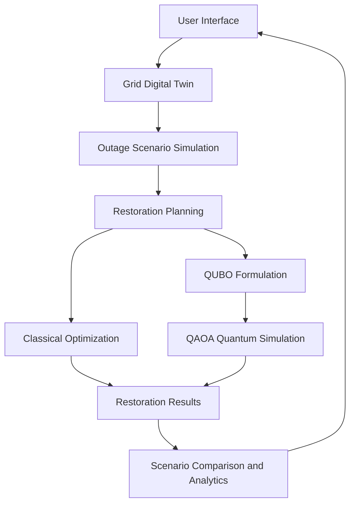
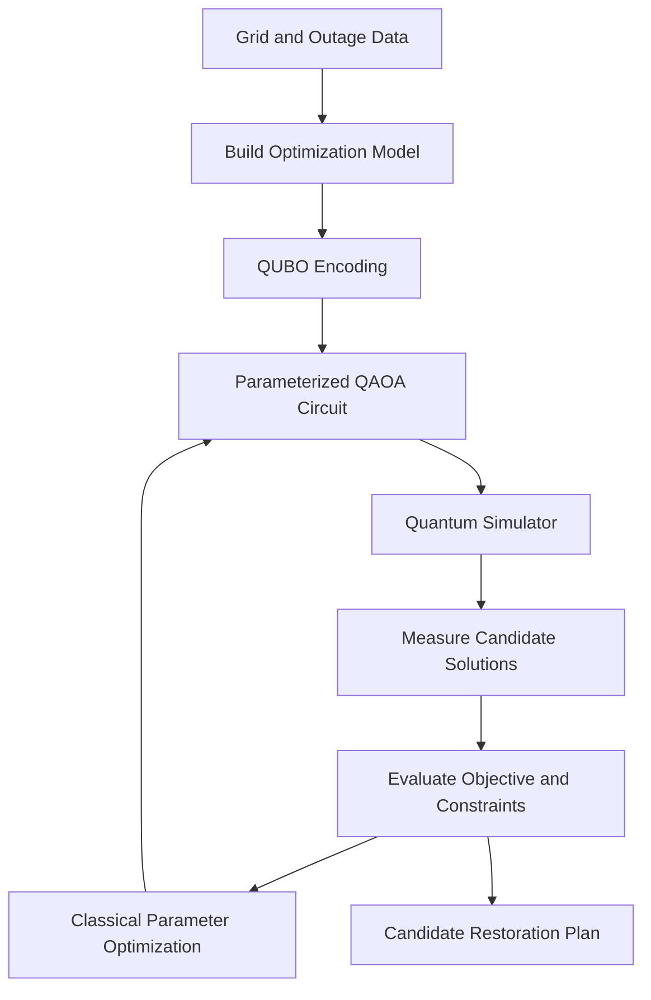

# ⚡ GridWeaver: A Hybrid Quantum-Classical Framework for Resilient Power Grid Restoration


**A hybrid quantum-classical optimization platform for simulating power grid disruptions, planning restoration strategies, and comparing classical and quantum-inspired optimization approaches.**

**Hackathon:** VTU Qiskit Fall Fest 2026  
**Team Name:** Entanglex  
**Team ID:** VTU-QFF-HC-0017  
**Tier:** Both  
**Selected Track:** Quantum + AI and ML

**Live Demo:** https://grid-weaver.vercel.app/  
**Presentation PPT** https://docs.google.com/presentation/d/1lrDSHkP3apoWaGc4jsUAXl4WVxwBQIfp/edit?usp=sharing&ouid=104835767600303298047&rtpof=true&sd=true


**Vedio Link** https://drive.google.com/file/d/1-FshpVLllzMD4DJVzDlvBDAjNZEP2oH8/view?usp=sharing

**Youtube Link** https://youtu.be/bQhphLGxcrA


---

## 📑 Table of Contents

- [1. Problem Statement](#-1-problem-statement)
- [2. Proposed Solution](#-2-proposed-solution)
- [3. Objectives](#-3-objectives)
- [4. Key Features](#-4-key-features)
- [5. Novelty and Innovation](#-5-novelty-and-innovation)
- [6. System Architecture](#-6-system-architecture)
- [7. Quantum Computing Approach](#-7-quantum-computing-approach)
- [8. Technology Stack](#-8-technology-stack)
- [9. Project Structure](#-9-project-structure)
- [10. Implementation Workflow](#-10-implementation-workflow)
- [11. Installation and Setup](#-11-installation-and-setup)
- [12. API Endpoints](#-12-api-endpoints)
- [13. Results and Evaluation](#-13-results-and-evaluation)
- [14. Real-World Applications and Impact](#-14-real-world-applications-and-impact)
- [15. Challenges and Limitations](#-15-challenges-and-limitations)
- [16. Future Scope](#-16-future-scope)
- [17. Demo and Resources](#-17-demo-and-resources)
- [18. Team](#-18-team)
- [19. Submission Checklist](#-19-submission-checklist)
- [20. References](#-20-references)
- [21. License](#-21-license)

---

## ⚡ 1. Problem Statement

Power grid disruptions caused by equipment failures, extreme weather, and other unexpected events can interrupt electricity supply to homes, hospitals, industries, and essential infrastructure.

Restoring electricity after an outage is a complex decision-making problem. Operators must determine which components to restore, which loads should receive priority, and how to satisfy grid connectivity, resource, and operational constraints.

Traditional approaches can become computationally challenging as the number of grid components, restoration choices, and constraints increases.

### Key Challenges

- **Power disruptions:** Outages can disconnect critical loads and interrupt essential services.
- **Complex decisions:** Multiple restoration actions may be possible, each with different costs and benefits.
- **Critical load prioritization:** Hospitals and other essential services may require higher restoration priority.
- **Operational constraints:** Restoration decisions must respect the modeled grid and resource constraints.
- **Optimization complexity:** Large decision spaces can make finding suitable restoration plans difficult.

GridWeaver explores how classical optimization and quantum optimization techniques can support a more transparent, data-driven restoration-planning workflow.

---

## 💡 2. Proposed Solution

GridWeaver is an interactive power grid restoration prototype that combines a grid digital twin, outage scenario simulation, classical optimization, and a quantum optimization workflow.

The platform allows users to explore grid disruptions, evaluate restoration options, and compare the resulting plans through a unified interface.

### Solution Components

1. **Grid Digital Twin:** Represents the modeled grid and its components.
2. **Scenario Simulation:** Lets users explore outage scenarios and their effects on the modeled network.
3. **Classical Restoration Solver:** Generates a restoration plan using classical optimization.
4. **Quantum Optimization Workflow:** Formulates a suitable optimization problem using QUBO and explores candidate solutions with QAOA.
5. **Comparative Analytics:** Presents available solver outputs and evaluation metrics to support comparison.

The objective is to investigate whether a hybrid quantum-classical approach can provide useful optimization alternatives for power grid restoration.

---

## 🎯 3. Objectives

- Develop an interactive representation of a power grid.
- Simulate outage scenarios and analyze their effects.
- Prioritize critical loads during restoration planning.
- Formulate restoration decisions as an optimization problem.
- Explore QUBO-based problem encoding and QAOA.
- Compare classical and quantum-based approaches using consistent evaluation metrics.
- Provide a visual interface for understanding restoration decisions.
- Identify opportunities and limitations of quantum optimization in energy infrastructure.

---

## 🚀 4. Key Features

### 4.1 Grid Digital Twin
An interactive representation of the modeled power grid for exploring its components and connectivity.

### 4.2 Scenario Simulation
Allows users to investigate hypothetical grid failures and examine their impact on the modeled network.

### 4.3 Restoration Planning
Provides a workflow for identifying candidate restoration actions under the implemented objective and constraints.

### 4.4 Classical Optimization
Uses a classical solver to establish a baseline for evaluating restoration plans.

### 4.5 Quantum Optimization
Explores QUBO formulation and the Quantum Approximate Optimization Algorithm (QAOA) using a quantum simulation workflow.

### 4.6 Scenario Comparison
Provides a dedicated interface for comparing available restoration plans and solver metrics.

### 4.7 Analytics Dashboard
Organizes grid and restoration information into a visual interface for easier interpretation.

### 4.8 Web-Based Interface
Makes the frontend accessible through a deployed web application without requiring users to run the frontend locally.

---

## ✨ 5. Novelty and Innovation

GridWeaver brings together power grid modeling and hybrid quantum-classical optimization in a single interactive prototype.

- **Energy-focused quantum optimization:** Applies quantum optimization concepts to the power grid restoration problem.
- **Hybrid architecture:** Combines classical optimization with a QUBO/QAOA-based workflow.
- **Interactive experimentation:** Enables users to explore outage scenarios and restoration decisions.
- **Comparative evaluation:** Provides a framework for examining differences between classical and quantum-based approaches.
- **Critical infrastructure focus:** Considers restoration priorities relevant to essential services.
- **Extensible design:** Provides a starting point for future work involving renewable energy, storage, and larger grid models.

**Innovation goal:** Investigate the practical usefulness of quantum optimization for grid restoration rather than assuming that quantum methods are automatically superior to classical solvers.

---

## 🏗️ 6. System Architecture

GridWeaver follows a frontend-backend architecture in which the web interface communicates with optimization services through HTTP APIs.



### Architecture Components

| Component | Responsibility |
|---|---|
| React frontend | User interaction and visual presentation |
| TypeScript | Frontend logic and type safety |
| FastAPI backend | Exposes simulation and optimization endpoints |
| Grid model | Represents the modeled network and restoration data |
| Classical solver | Computes candidate plans using classical optimization |
| QUBO formulation | Encodes a compatible optimization problem |
| QAOA workflow | Explores candidate solutions using a parameterized quantum circuit |
| Analytics interface | Presents available results for comparison |

The architecture is intended to separate the user interface from the optimization logic, allowing the backend and frontend to be developed and tested independently.

---

## ⚛️ 7. Quantum Computing Approach

GridWeaver explores the use of quantum optimization for a constrained restoration-planning problem.

### 7.1 QUBO Formulation

Quadratic Unconstrained Binary Optimization (QUBO) represents an optimization problem using binary decision variables and a quadratic objective function.

A general QUBO objective is:

\[
\min_{x\in\{0,1\}^{n}} x^TQx
\]

where:

- \(x\) is a vector of binary decision variables.
- \(Q\) contains the objective coefficients and pairwise interactions.
- The objective represents the optimization priorities and any encoded penalty terms.

For GridWeaver, the formulation is intended to represent restoration decisions, priorities, and applicable constraints. The exact mapping depends on the implemented grid model.

### 7.2 Quantum Approximate Optimization Algorithm

QAOA is a hybrid quantum-classical algorithm that uses a parameterized quantum circuit and a classical optimization loop.

The general workflow is:

1. Encode the optimization problem into a cost Hamiltonian.
2. Initialize a quantum state.
3. Apply parameterized cost and mixer operations.
4. Measure the circuit to obtain candidate bitstrings.
5. Evaluate candidates using the objective function.
6. Update circuit parameters using a classical optimizer.
7. Select and evaluate a candidate restoration plan.

### 7.3 Hybrid Quantum-Classical Workflow



### 7.4 Quantum Advantage: Evaluation, Not Assumption

The project investigates how a quantum optimization workflow compares with a classical baseline. A quantum advantage is **not assumed**.

A defensible evaluation should compare:

- Solution quality and objective value.
- Constraint feasibility.
- Total demand restored, where measured by the model.
- Runtime under comparable test conditions.
- Scalability as the problem size increases.

Results must be obtained from actual executions using documented settings. A quantum simulator demonstrates an algorithmic workflow, but it does not by itself establish an advantage over classical optimization or prove performance on real quantum hardware.

---

## 🧰 8. Technology Stack

| Technology | Purpose |
|---|---|
| React | Interactive frontend |
| TypeScript | Frontend logic and type safety |
| Vite | Frontend development and build tooling |
| Python | Backend and optimization logic |
| FastAPI | REST API development |
| Qiskit | Quantum circuit and algorithm development |
| Qiskit Aer | Quantum circuit simulation, if configured in the backend |
| OR-Tools | Classical optimization, where used by the implementation |
| REST API / JSON | Frontend-backend communication |
| Git and GitHub | Version control and collaboration |
| Vercel | Web deployment |

*The precise packages and versions should be confirmed against the project's dependency files before final submission.*

---

## 📁 9. Project Structure

The following is a high-level overview of the expected project organization. Refer to the repository for the definitive file structure.

```text
GridWeaver/
├── src/
│   ├── components/
│   ├── services/
│   │   └── apiClient.ts
│   ├── models/
│   └── ...
├── public/
├── python_backend/
│   ├── main.py
│   └── ...
├── app/
├── package.json
├── package-lock.json
├── tsconfig.json
├── vite.config.ts
├── .gitignore
├── .env.example
└── README.md
```

**Note:** The actual files and directories may differ. Confirm the entry points and module names in the submitted repository before relying on this illustrative structure.

---

## 🔧 10. Implementation Workflow

### Step 1: Model the Grid
Represent the network components, connections, loads, and restoration-related information required by the application.

### Step 2: Simulate an Outage
Select or configure a scenario and update the modeled grid state according to the implemented simulation logic.

### Step 3: Generate a Classical Baseline
Pass the modeled restoration problem to the classical solver and collect the resulting plan and available metrics.

### Step 4: Prepare the Quantum Optimization Problem
Translate the supported optimization formulation into QUBO form.

### Step 5: Execute the QAOA Workflow
Run the configured quantum circuit simulation and evaluate the candidate solutions returned by the workflow.

### Step 6: Compare Results
Present the available classical and quantum workflow outputs, including solution quality, feasibility, and runtime when measured.

### Step 7: Visualize Findings
Use the web interface to make scenario details and restoration comparisons easier to understand.

---

## 💻 11. Installation and Setup

### Prerequisites

- Node.js and npm
- Python 3.10 or another version supported by the backend dependencies
- Git
- A code editor such as Visual Studio Code

### 11.1 Clone the Repository

```bash
git clone https://github.com/priyankasunagar/GridWeaver.git
cd GridWeaver
```

### 11.2 Install Frontend Dependencies

```bash
npm install
```

### 11.3 Start the Frontend

```bash
npm run dev
```

Open the local URL printed in the terminal by Vite.

### 11.4 Configure the Backend

Open a separate terminal:

```bash
cd python_backend
```

Create and activate a virtual environment on Windows:

```powershell
py -m venv .venv
.\.venv\Scripts\Activate.ps1
```

Install the dependencies listed in the backend's dependency file. For example, if the project provides `requirements.txt`:

```powershell
pip install -r requirements.txt
```

Start the API using the actual Python entry point and server command specified in the repository. For example, if the entry point is `main.py` and it exposes `app`:

```powershell
uvicorn main:app --reload --port 8000
```

If the backend entry point or dependency file has a different name, adjust these commands to match the repository.

### 11.5 Configure the API URL

The frontend must point to a reachable backend.

For local development, use the local backend URL if the frontend configuration supports it:

```text
http://localhost:8000
```

For the deployed frontend, configure the deployed backend URL:

```text
https://grid-weaver-25cf.vercel.app
```

If the frontend reads `VITE_API_BASE_URL`, set it in the appropriate local environment file or deployment environment settings.

**Important:** A successful frontend deployment does not guarantee that every backend endpoint is operational. Verify the health check and test each required endpoint before presenting the complete workflow as functional.

---

## 🔌 12. API Endpoints

The backend is designed around the following endpoints. Verify the actual routes, HTTP methods, request schemas, and response schemas against the deployed API or backend source code.

| Method | Endpoint | Purpose |
|---|---|---|
| GET | `/health` | Check backend health |
| GET | `/api/grid` | Retrieve grid data |
| POST | `/api/scenarios/simulate` | Simulate an outage scenario |
| POST | `/api/restoration/solve-classical` | Run classical restoration optimization |
| POST | `/api/quantum/qubo` | Prepare or retrieve QUBO formulation |
| POST | `/api/quantum/solve-qaoa` | Execute the QAOA workflow |
| POST | `/api/compare` | Compare available solver outputs |


### API Documentation

If enabled by the backend configuration, FastAPI's interactive API documentation is available at:

```text
https://grid-weaver-25cf.vercel.app/docs
```

If the documentation endpoint is unavailable, inspect the deployment logs and backend routing configuration.

---

## 📊 13. Results and Evaluation

GridWeaver provides a framework for evaluating restoration plans and comparing classical and quantum optimization workflows.

### Evaluation Metrics

| Metric | Purpose |
|---|---|
| Restored demand | Measures the modeled demand restored by a candidate plan |
| Critical load recovery | Evaluates restoration of prioritized loads |
| Constraint feasibility | Checks whether a candidate satisfies the encoded constraints |
| Objective value | Measures the candidate against the optimization objective |
| Solver runtime | Measures the time taken by the solver under documented conditions |
| Problem size | Records the size of the grid or optimization instance |

### Analysis Method

- Run both workflows on equivalent problem instances where supported.
- Use consistent objective functions and constraint definitions.
- Record the configuration, solver settings, and runtime conditions.
- Compare solution quality and feasibility before drawing conclusions.
- Repeat runs when stochastic behavior may affect results.
- Document unsupported or failed solver executions rather than omitting them.

### Results Reporting

Actual numerical results should be added after testing the submitted version of the application. Do not treat mock dashboard values, illustrative screenshots, or unverified outputs as measured experimental results.

The evaluation should answer three questions:

1. Can the system generate a valid restoration plan for the tested scenario?
2. How do the classical and quantum workflows compare under the same conditions?
3. What are the limitations of the current prototype, and what evidence would be needed to demonstrate an advantage?

---

## 🌍 14. Real-World Applications and Impact

### Potential Applications

- **Smart grids:** Support exploration of restoration strategies after modeled disruptions.
- **Hospitals and emergency services:** Study prioritization of essential electricity loads.
- **Disaster management:** Evaluate hypothetical grid outages and restoration decisions.
- **Utility planning:** Explore alternative restoration strategies using a digital model.
- **Renewable energy systems:** Extend the optimization model to include distributed generation and storage.
- **Research and education:** Demonstrate QUBO and QAOA concepts through an energy-related use case.

### Expected Impact

GridWeaver aims to make grid restoration optimization easier to explore and evaluate. Its immediate contribution is a research and demonstration prototype, not a replacement for operational grid-control systems.

Real-world deployment would require validated grid models, power-system engineering review, security controls, and extensive testing.

---

## ⚠️ 15. Challenges and Limitations

- **Optimization complexity:** Restoration decisions can involve many interacting variables and constraints.
- **QUBO encoding:** The mathematical formulation must accurately reflect the intended restoration problem.
- **Quantum simulation cost:** Simulation can become computationally expensive as circuit size increases.
- **Backend reliability:** Solver requests can fail or time out if dependencies, routes, or deployment resources are misconfigured.
- **Model simplification:** A prototype grid may not capture all electrical, protection, and operational constraints of a real network.
- **Fair comparison:** Classical and quantum workflows must use comparable objectives and test conditions.
- **No established quantum advantage:** Any performance improvement must be demonstrated experimentally.

---

## 🔮 16. Future Scope

- Integrate validated power-flow and network constraints.
- Evaluate larger grid-restoration benchmark instances.
- Improve the reliability and observability of backend solver execution.
- Benchmark QAOA against additional classical optimization methods.
- Explore quantum hardware execution where suitable access is available.
- Incorporate renewable generation, battery storage, and demand response.
- Add uncertainty-aware restoration planning.
- Integrate real-time outage data where reliable data sources are available.
- Provide reproducible benchmark reports with documented experimental settings.

---

## 🎥 17. Demo and Resources

### Live Application

https://grid-weaver.vercel.app/

### Source Code

https://github.com/priyankasunagar/GridWeaver


### Demo Video

Add the public demo recording link here after uploading the video and verifying its sharing permissions.

```text
https://drive.google.com/file/d/1-FshpVLllzMD4DJVzDlvBDAjNZEP2oH8/view?usp=sharing
```

### Suggested Demo Flow

1. Introduce the GridWeaver dashboard.
2. Open the Grid Digital Twin.
3. Configure and simulate an outage scenario.
4. Demonstrate restoration planning.
5. Run the classical solver.
6. Demonstrate the QUBO and QAOA workflow if operational.
7. Open Scenario Comparison and explain the available metrics.
8. Conclude with limitations and future scope.

---

## 👥 18. Team

| Field | Details |
|---|---|
| Team Name | Entanglex |
| Team ID | VTU-QFF-HC-0017 |
| Team Tier | Both |
| Project | GridWeaver |
| Track | Quantum + AI and ML |

### Team Members

| Name | Role |
|---|---|
| Priyanka Sunagar | Project development and integration |
| Rajashree gasti | Developer |
| Poornima bhavi | Developer|

Update the team name, team ID, and member list if these do not match the team's official hackathon registration.

---

## ✅ 19. Submission Checklist

- [ ] Confirm that the repository contains the complete source code.
- [ ] Verify the README setup commands against the actual project.
- [ ] Ensure dependency and environment configuration files are included.
- [ ] Remove secrets, private API keys, and local environment files from the repository.
- [ ] Verify that the deployed frontend opens correctly.
- [ ] Test the backend health endpoint.
- [ ] Test the classical and quantum solver endpoints independently.
- [ ] Capture genuine screenshots of the working prototype.
- [ ] Record and link the demonstration video.
- [ ] Document actual evaluation results and known limitations.
- [ ] Confirm that the official team information is correct.
- [ ] Verify that the repository follows the hackathon's submission and branch requirements.

---

## 📚 20. References

1. IBM Quantum Documentation — https://quantum.ibm.com/docs
2. Qiskit Documentation — https://docs.quantum.ibm.com/
3. Qiskit Textbook — https://qiskit.qotlabs.org/learning
4. Google OR-Tools Documentation — https://developers.google.com/optimization
5. FastAPI Documentation — https://fastapi.tiangolo.com/
6. React Documentation — https://react.dev/
7. Vite Documentation — https://vite.dev/

These references provide background on the technologies used in the project. Add any specific research papers, benchmark datasets, or mathematical references used in the actual implementation.

---

## 📄 21. License

Refer to the repository's `LICENSE` file for the applicable licensing terms. Do not claim a particular license unless it is included in the submitted repository.

---

**GridWeaver — Exploring hybrid quantum-classical optimization for a more resilient power grid.**
